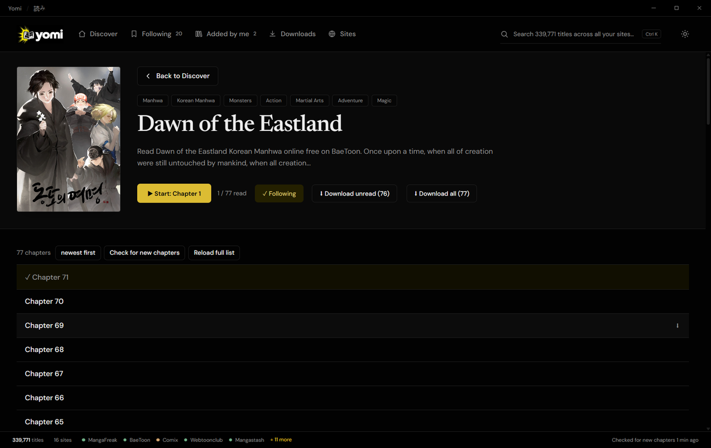

<p align="center">
  
</p>

<p align="center">
  <b>All your manga, manhwa and manhua sites in one clean, ad-free reader for Windows.</b><br>
  <a href="https://github.com/hmodymac8-droid/yomi/releases/latest"><b>⬇ Download for Windows</b></a>
  &nbsp;·&nbsp; <a href="#العربية">العربية</a>
</p>

<p align="center">
  
  
  
</p>

<p align="center">
  
  
</p>

## What it does

- **Add any site.** Paste its address and every title joins one big catalog.
- **Search everything at once**, filter by type and genre, sort how you like.
- **English or Arabic**: one click shows only English sites or only Arabic sites.
- **Read without ads** in Yomi's own reader.
- **Follow series** and see new chapters as they come out.
- **Download chapters** to read offline, or export them as CBZ.
- Dark and light themes.

## How to use

1. Download **Yomi-Setup** from [Releases](https://github.com/hmodymac8-droid/yomi/releases/latest) and run it.
   If Windows shows *"Windows protected your PC"*, click **More info → Run anyway**.
2. On **Discover**, paste a manga site's address into **Add a site** and press **Add**.
3. Search with the top bar (**Ctrl + K**), open a title, and press **Start** or **Continue**.
4. Press **☆ Follow** to get new chapters, or **⬇** to save chapters for offline.

## Sites tested and working

Every site below was tested end to end: title list, chapters, pages and images.

| English | | Arabic · عربي |
|---|---|---|
| MangaFreak · Manganato · Mangapill | manga, manhwa, manhua | Azorafly |
| Weebcentral · Mangastash · Kuramanga | manga, manhwa, manhua | Olympustaff |
| ManhwaTop · BaeToon · Webtoonclub | manhwa, webtoons | Mangadar |
| Manhuatop | manhua | Mangasid |
| Projectsuki | manga | |

<sub>Comix also works, but its chapter lists can be slow to load.</sub>

## Build from source

```bash
npm install
npm run dev        # run the app
npm run build:win  # make the installer in dist/
```

<br>

<div dir="rtl" align="right">

<h2 id="العربية">العربية</h2>

**يومي (Yomi)**: كل مواقع المانجا والمانهوا والمانها في قارئ واحد نظيف وبدون إعلانات على ويندوز.

### ماذا يفعل

- **أضف أي موقع**: الصق رابطه وتنضم كل أعماله إلى مكتبة واحدة.
- **ابحث في كل المواقع معاً**، وصفِّ حسب النوع والتصنيف، ورتّب كما تحب.
- **عربي أو إنجليزي**: بضغطة واحدة تعرض المواقع العربية فقط أو الإنجليزية فقط.
- **اقرأ بدون إعلانات** في قارئ يومي الخاص.
- **تابع الأعمال** واعرف الفصول الجديدة فور صدورها.
- **حمّل الفصول** للقراءة بدون إنترنت، أو صدّرها كملفات CBZ.
- وضع داكن ووضع فاتح.

### طريقة الاستخدام

1. حمّل **Yomi-Setup** من صفحة [الإصدارات](https://github.com/hmodymac8-droid/yomi/releases/latest) وشغّله.
   إذا ظهرت رسالة *"Windows protected your PC"* اضغط **More info** ثم **Run anyway**.
2. في صفحة **Discover** الصق رابط موقع مانجا في خانة **Add a site** واضغط **Add**.
3. ابحث من الشريط العلوي (**Ctrl + K**)، افتح أي عمل، واضغط **Start** أو **Continue**.
4. اضغط **☆ Follow** لتصلك الفصول الجديدة، أو **⬇** لحفظ الفصول للقراءة بدون إنترنت.

### مواقع تمت تجربتها وتعمل

**المواقع العربية:** Azorafly · Olympustaff · Mangadar · Mangasid

**المواقع الإنجليزية:** MangaFreak · Manganato · Mangapill · Weebcentral · Mangastash · Kuramanga · ManhwaTop · BaeToon · Webtoonclub · Manhuatop · Projectsuki

</div>

<br>

<p align="center"><sub>For personal use. Yomi only shows what the sites themselves publish and follows their robots.txt rules.</sub></p>
